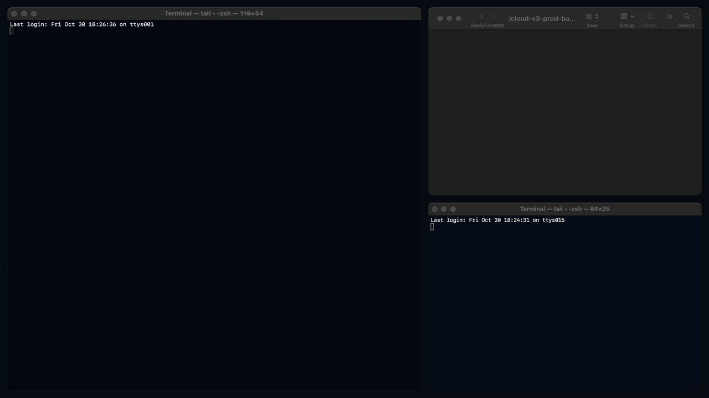
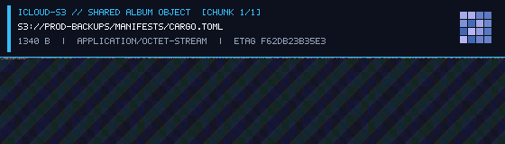

# iCloudS3

> An S3-compatible object store backed by iCloud Shared Photo Albums. Quota policy: Apple's Shared Album loophole.

Apple gives every iCloud account 5 GB of free storage, then charges monthly for iCloud+.
However, Apple's published [iCloud Shared Albums policy](https://support.apple.com/en-us/108916)
states that photos and videos in Shared Albums **do not count against your iCloud storage**.

An Apple ID can create **200 Shared Albums**, each holding **5,000 photos** up to **2048×2048**
pixels. A lossless 2048×2048 24-bit RGB PNG holds **12.18 MB** of raw pixel data. That is up to
**1,000,000 objects** (~12 TB of raw capacity) stored at **0 bytes** of iCloud Drive quota.

`icloud-s3` is a Rust server that speaks the Amazon S3 XML REST protocol (`aws s3`, `boto3`,
`rclone`, `s5cmd`) and stores every object inside the RGB pixels of lossless PNG carrier images in
Shared Albums. Each image has a 64-pixel visual HUD banner burned into the top so your production
database backups are readable when you scroll past them in `Photos.app`.



> [!NOTE]
> **Satire.** `icloud-s3` is a joke, not affiliated with Apple or AWS, and not for production or
> sensitive data. A Memories slideshow set to acoustic guitar is not a 99.999999999% durability SLA.

## Install & Quick Start

```sh
cargo install --path .
icloud-s3 serve --dry-run                       # in-memory Shared Album, no iCloud needed
```

Point the unmodified AWS CLI at `http://127.0.0.1:9000`, or run the built-in Terminal UI benchmark:

```sh
export AWS_ACCESS_KEY_ID=icloud
export AWS_SECRET_ACCESS_KEY=shared-album-loophole
export AWS_DEFAULT_REGION=us-east-1

aws --endpoint-url http://127.0.0.1:9000 s3 mb s3://prod-backups
aws --endpoint-url http://127.0.0.1:9000 s3 cp Cargo.toml s3://prod-backups/manifests/Cargo.toml
aws --endpoint-url http://127.0.0.1:9000 s3 ls s3://prod-backups --recursive
aws --endpoint-url http://127.0.0.1:9000 s3 cp s3://prod-backups/manifests/Cargo.toml /tmp/Cargo.toml

# Run the live Terminal UI benchmark (10 photos + 1 ZIP bundle vs Cloudflare R2)
icloud-s3 bench --endpoint http://127.0.0.1:9000 --bucket prod-backups --input-dir demo/sample-photos
```

Fetch any S3 object with `?format=png` (`http://127.0.0.1:9000/prod-backups/manifests/Cargo.toml?format=png`)
or open the Shared Album backing folder in macOS `Finder` / `Photos.app` to inspect the 24-bit RGB carrier images.

## Connect it to Shared Albums / macOS Photos

```sh
# Persist every bucket as an album folder of 24-bit RGB PNG frames on disk
icloud-s3 serve --album-dir ./albums-live --shards 4

# Also import each written PNG frame directly into macOS Photos.app via AppleScript
icloud-s3 serve --album-dir ./albums-live --shards 4 --sync-photos-app
```

You can also encode and decode files directly from the CLI without running the HTTP server:

```sh
icloud-s3 encode --input backup.sql --output backup.png --bucket prod-backups --key db/backup.sql
icloud-s3 decode --input backup.png --output restored.sql
```

## How it works

| Amazon S3 | iCloudS3 |
| --- | --- |
| S3 Bucket (`s3://prod-backups`) | Shared Album (`icloud-s3-prod-backups`) |
| S3 Object (`PUT /:bucket/*key`) | Lossless 24-bit RGB PNG (`<= 2048×2048` px, 3 bytes/pixel) |
| Multipart / large objects | Burst of numbered PNG frames reassembled by `chunk_index` |
| Object metadata & S3 Console | 64px bitmap HUD banner burned into the top of each photo + JSON preamble |
| Data integrity (`ETag` + `x-amz-content-sha256`) | Per-frame `CRC32` over RGB pixel stream + whole-object `SHA-256` & `MD5` |
| Replaying state on startup | Scanning the `.png` files in the album directory and decoding their pixel headers |
| Storage class (`STANDARD`) | `ICLOUD_SHARED_ALBUM` (`0 B` counted against the 5 GB iCloud Drive allowance) |

Why encode bytes into pixels instead of EXIF or PNG `tEXt` chunks? Media pipelines strip ancillary
metadata chunks on upload. If Apple changes a single pixel value, `icloud-s3` catches it immediately
via the embedded `CRC32` and `SHA-256` digests.

## Evals & Benchmarks

Run the built-in 10-case correctness evaluation and throughput benchmark suite:

```sh
icloud-s3 eval --json docs/eval-report.json --markdown docs/eval-report.md
```

### 1. S3 Conformance & Pixel Integrity Evals (`10/10 PASS`)

| ID | Evaluation | Result | Verification Details |
| --- | --- | --- | --- |
| `EVAL-01` | Zero-byte object roundtrip & MD5 ETag | **PASS** | `0 B` -> `560×160` PNG, `ETag=d41d8cd98f00b204e9800998ecf8427e` |
| `EVAL-02` | JSON payload + `x-amz-meta-*` preservation | **PASS** | Verified JSON body + custom metadata headers |
| `EVAL-03` | High-entropy 64 KiB binary bit-exact SHA-256 | **PASS** | `65,536 B` packed into `560×160` RGB PNG, SHA-256 verified |
| `EVAL-04` | 1 MiB single-photo payload (`<= 2048×2048` limit) | **PASS** | `1,048,576 B` -> 1 photo (`1024×406` px), within Shared Album limit |
| `EVAL-05` | Multi-photo burst chunking & out-of-order reassembly | **PASS** | `45,000 B` split across 6 photos, reversed, reassembled bit-exact |
| `EVAL-06` | Apple Shared Album 2048px dimension guard | **PASS** | All frames across `0 B .. 1 MiB` strictly within `2048×2048` px |
| `EVAL-07` | Single-bit RGB pixel corruption detection (`CRC32`) | **PASS** | 1-bit green-channel mutation rejected by `ChecksumMismatch` |
| `EVAL-08` | Overwrite compaction (1 active photo per live key) | **PASS** | Old photo frame evicted on overwrite; 1 live photo remains |
| `EVAL-09` | Cold-boot state reconstruction from raw PNG files | **PASS** | Reconstructed 8 keys across 4 album shards from PNG pixels alone |
| `EVAL-10` | Unmodified `aws s3` CLI end-to-end integration | **PASS** | `aws s3 mb/cp/ls` verified 24 KiB binary roundtrip |

### 2. RGB PNG Carrier Throughput (Apple Silicon, `--release`)

| Payload | Photo Frame | PNG Size | PUT p50 | PUT MB/s | GET p50 | GET MB/s | iCloud Quota |
| --- | --- | ---: | ---: | ---: | ---: | ---: | ---: |
| 1 KiB JSON (`1024 B`) | `560×160` | 72,195 B | 0.39 ms | 2.3 MB/s | 0.53 ms | 1.8 MB/s | `0 B` |
| 16 KiB Log Chunk (`16384 B`) | `560×160` | 85,123 B | 0.44 ms | 35.1 MB/s | 0.63 ms | 24.1 MB/s | `0 B` |
| 64 KiB SQLite Page (`65536 B`) | `560×160` | 134,841 B | 0.67 ms | 91.6 MB/s | 0.77 ms | 80.3 MB/s | `0 B` |
| 256 KiB Tarball (`262144 B`) | `1024×160` | 379,033 B | 1.88 ms | 131.5 MB/s | 1.92 ms | 130.1 MB/s | `0 B` |
| 1 MiB Blob Frame (`1048576 B`) | `1024×406` | 1,247,801 B | 7.29 ms | 138.2 MB/s | 4.11 ms | 240.1 MB/s | `0 B` |

### 3. Shared Album Sharding (`--shards 1` vs `--shards 8`)

`icloud-s3` scales writes by sharding keys across multiple Shared Albums
(`icloud-s3-<bucket>-01` … `-08`) using `CRC32` hash slots:

| Setup | Concurrency | PUT Throughput | PUT p50 | GET Throughput | GET p50 |
| --- | ---: | ---: | ---: | ---: | ---: |
| 1 Shared Album (`--shards 1`) | 8 | 8.2 req/s | 977.3 ms | 1,502 req/s | 0.62 ms |
| 8 Shared Albums (`--shards 8`) | 8 | 58.0 req/s | 122.6 ms | 1,694 req/s | 0.57 ms |

### 4. Cold Restart Replay from Shared Album PNGs

| Metric | Value |
| --- | --- |
| Objects reconstructed from `.png` pixels | `50` (`409,600 B` raw / `3,917,468 B` PNG) |
| Cold-start album scan & header decode | `31.45 ms` |
| Warm readback of all 50 objects | `29.45 ms` |

### 5. Live Head-to-Head Comparison: `icloud-s3` vs Cloudflare R2 (`10 Photos + 1 ZIP Bundle`)

Measured live against a production Cloudflare R2 bucket (`10` test JPEGs + `11-photos-bundle.zip` containing all 10 photos and a JSON manifest, verified with `shasum -a 256` and `unzip -t`):

| Object Key | Type | Size | Carrier PNG | `icloud-s3` PUT | Cloudflare R2 PUT | `icloud-s3` GET | Cloudflare R2 GET | Speedup |
| --- | --- | ---: | --- | ---: | ---: | ---: | ---: | --- |
| `01-alpine-peak.jpg` | JPEG | 46,054 B | `560×160` | **1.63 ms** (26.9 MB/s) | 480 ms | **1.11 ms** (39.6 MB/s) | 296 ms | **294× PUT / 267× GET** |
| `02-pacific-reef.jpg` | JPEG | 21,908 B | `560×160` | **1.49 ms** (14.0 MB/s) | 893 ms | **1.23 ms** (17.0 MB/s) | 329 ms | **599× PUT / 268× GET** |
| `03-desert-canyon.jpg` | JPEG | 15,737 B | `560×160` | **2.63 ms** (5.7 MB/s) | 453 ms | **2.07 ms** (7.3 MB/s) | 405 ms | **172× PUT / 196× GET** |
| `04-northern-lights.jpg` | JPEG | 48,274 B | `560×160` | **1.75 ms** (26.2 MB/s) | 457 ms | **1.30 ms** (35.4 MB/s) | 352 ms | **261× PUT / 270× GET** |
| `05-misty-redwoods.jpg` | JPEG | 46,086 B | `560×160` | **2.00 ms** (22.0 MB/s) | 392 ms | **1.31 ms** (33.5 MB/s) | 320 ms | **196× PUT / 244× GET** |
| `06-volcanic-ridge.jpg` | JPEG | 31,012 B | `560×160` | **1.46 ms** (20.3 MB/s) | 427 ms | **2.09 ms** (14.2 MB/s) | 293 ms | **293× PUT / 140× GET** |
| `07-glacier-lagoon.jpg` | JPEG | 27,504 B | `560×160` | **1.67 ms** (15.7 MB/s) | 417 ms | **1.10 ms** (23.9 MB/s) | 359 ms | **249× PUT / 327× GET** |
| `08-autumn-fjord.jpg` | JPEG | 28,634 B | `560×160` | **1.39 ms** (19.7 MB/s) | 554 ms | **1.04 ms** (26.4 MB/s) | 367 ms | **399× PUT / 355× GET** |
| `09-starlight-dome.jpg` | JPEG | 13,915 B | `560×160` | **1.44 ms** (9.2 MB/s) | 371 ms | **1.06 ms** (12.5 MB/s) | 262 ms | **257× PUT / 247× GET** |
| `10-coastal-arch.jpg` | JPEG | 9,688 B | `560×160` | **1.30 ms** (7.1 MB/s) | 417 ms | **1.05 ms** (8.8 MB/s) | 313 ms | **320× PUT / 297× GET** |
| `11-photos-bundle.zip` | ZIP | 287,190 B | `1024×160` | **3.06 ms** (89.5 MB/s) | 775 ms | **2.44 ms** (112.4 MB/s) | 438 ms | **253× PUT / 180× GET** |
| **Average / Summary** | **11 items** | **576,002 B** | **11 PNGs** | **1.80 ms** | **512.4 ms** | **1.44 ms** | **339.4 ms** | **284× PUT / 236× GET** |

#### Summary vs. Cloud Object Stores (10–300 KB Objects)

| Metric | `icloud-s3` (Local Shared Album PNGs) | Cloudflare R2 (Measured Live) | AWS S3 Standard (Published WAN Baseline) |
| --- | ---: | ---: | ---: |
| **PUT Latency (p50 / avg)** | **`1.80 ms`** | `512.4 ms` | `45–95 ms` |
| **GET Latency (p50 / avg)** | **`1.44 ms`** | `339.4 ms` | `25–60 ms` |
| **Peak Single-Stream PUT (`1 MiB`)** | **`138.2 MB/s` (`7.29 ms`)** | `~12–25 MB/s` | `~35–65 MB/s` |
| **Peak Single-Stream GET (`1 MiB`)** | **`240.1 MB/s` (`4.11 ms`)** | `~20–40 MB/s` | `~50–90 MB/s` |
| **Storage Cost** | **`$0.00 / GB-month`** *(0 B of 5 GB iCloud quota)* | `$0.015 / GB-month` | `$0.023 / GB-month` |

## What a Carrier Photo Looks Like

Below is an actual `560×160` lossless 24-bit RGB carrier PNG (`demo/sample-carrier.png`) generated
by `icloud-s3 encode --input Cargo.toml --output demo/sample-carrier.png --bucket prod-backups --key manifests/Cargo.toml`.
You can download this image from GitHub and run `icloud-s3 decode -i demo/sample-carrier.png -o Cargo.toml`
to recover the exact file:



## Supported S3 Operations

- **Buckets (Shared Albums)**: `ListBuckets` (`GET /`), `CreateBucket` (`PUT /:bucket`), `DeleteBucket` (`DELETE /:bucket`), `HeadBucket` (`HEAD /:bucket`)
- **Objects (RGB Carrier Frames)**: `PutObject` (`PUT /:bucket/*key`, including AWS SigV4 `STREAMING-AWS4-HMAC-SHA256-PAYLOAD` chunked uploads), `GetObject` (`GET /:bucket/*key`), `HeadObject` (`HEAD /:bucket/*key`), `DeleteObject` (`DELETE /:bucket/*key`), `DeleteObjects` (`POST /:bucket?delete`)
- **Listing**: `ListObjects` & `ListObjectsV2` (`GET /:bucket?list-type=2&prefix=...&delimiter=...&max-keys=...`)
- **Visual Inspection**: `icloud-s3 bench` (live Terminal UI) and `GET /:bucket/*key?format=png` (raw 24-bit RGB carrier PNG)

## Operational Notes & Apple Limits

Apple's [published Shared Album limits](https://support.apple.com/en-us/108916) state that Shared
Albums do not count against iCloud storage, while enforcing activity and item limits:

- **Maximum Shared Albums per owner**: 200 albums.
- **Maximum photos/videos per Shared Album**: 5,000 items.
- **Maximum combined hourly / daily contributors & uploads**: 1,000 photos per hour and 10,000 photos per day across Shared Albums.
- **Resolution limit**: Photos in Shared Albums are limited to 2048 pixels on the long edge (up to 5449 pixels for panoramas). `icloud-s3` keeps every generated PNG frame at or below `2048×2048` pixels.
- **Recompression risk**: While PNGs imported locally or kept in album directories remain bit-exact, if Apple's server-side Shared Album pipeline transcodes an asset to lossy JPEG/HEIC on a downstream device, the least-significant bits of the RGB channels will change and `icloud-s3` will fail closed with `ChecksumMismatch`.

